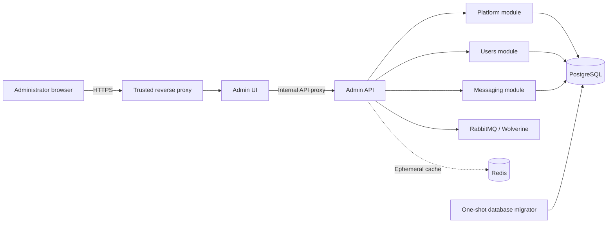

<div align="center">
  

# Veritas

**An experimental, self-hostable authentication service and identity provider.**

[](https://github.com/JamieKennedy/veritas-idp/actions/workflows/pipeline.yml)
[](https://jamiekennedy.github.io/veritas-idp/)
[](https://github.com/JamieKennedy/veritas-idp/releases)
[](LICENSE)

[Read the documentation](https://jamiekennedy.github.io/veritas-idp/) · [Install with Docker Compose](https://jamiekennedy.github.io/veritas-idp/operations/docker-compose/) · [Contribute](CONTRIBUTING.md)

</div>

> [!WARNING]
> Veritas is pre-alpha software. It is incomplete, receives breaking changes without migration guarantees, and must not be used to protect production systems or real user identities.

## What Veritas is

Veritas is being built as a self-hostable identity provider with conservative security defaults, observable failure modes, and an operationally clear deployment model. The backend is a .NET 11 modular monolith, the administration experience is React, local orchestration uses .NET Aspire, and releases are packaged for Docker Compose.

The project is currently focused on the secure administration and platform foundations required before OAuth 2.0 and OpenID Connect can be introduced.

## Implemented today

- Guarded first-run bootstrap and initial administrator creation.
- Password hashing, mandatory TOTP enrollment, one-time recovery codes, and server-side administrator sessions.
- CSRF protection, restricted credentialed CORS, secure cookies, and rate limiting on sensitive endpoints.
- Protected SMTP configuration, connectivity testing, templates, and asynchronous email delivery.
- Module-owned PostgreSQL schemas and migrations with a one-shot, locked migrator.
- Production-shaped Docker Compose packaging with private infrastructure networks, health checks, persistent state, and immutable release images.
- Shared structured logging, health endpoints, OpenTelemetry instrumentation, and dependency resilience defaults.

## Not implemented yet

OAuth 2.0, OpenID Connect, public-user authentication, client and project management, signing-key management, federation, comprehensive audit storage, webhooks, production-scale high availability, and production upgrade guarantees are not implemented.

See the [documentation overview](https://jamiekennedy.github.io/veritas-idp/) and [threat model](docs/security/threat-model.md) for the exact current scope and limitations.

## Architecture



Modules follow onion architecture and own their persistence boundaries. Immediate cross-module work uses in-process Application ports; durable side effects use versioned Wolverine/RabbitMQ messages that never carry raw secrets.

Read the [architecture guide](https://jamiekennedy.github.io/veritas-idp/engineering/architecture/) for module ownership, dependency direction, startup ordering, and trust boundaries.

## Install with Docker Compose

Use an exact versioned bundle from [GitHub Releases](https://github.com/JamieKennedy/veritas-idp/releases). The bundle contains `compose.yaml`, a version-pinned `.env.example`, and deployment guidance.

Before starting:

1. Read the [Docker Compose deployment guide](https://jamiekennedy.github.io/veritas-idp/operations/docker-compose/).
2. Generate independent credentials using the [secret-management guide](https://jamiekennedy.github.io/veritas-idp/operations/secrets/).
3. Put the loopback-bound Admin UI behind a [trusted HTTPS reverse proxy](https://jamiekennedy.github.io/veritas-idp/operations/reverse-proxy/).
4. Back up PostgreSQL and Data Protection state before every upgrade.

Do not expose Admin API, PostgreSQL, Redis, or RabbitMQ directly to untrusted networks.

## Develop locally

Install .NET 11, Node.js 22, pnpm 10.15.1, Aspire CLI 17.0.0, and Docker. Configure a development-only Aspire bootstrap secret, then start the full stack:

```powershell
pnpm restore
dotnet user-secrets --project src/orchestration/aspire/Veritas.AppHost set "Parameters:bootstrap-secret" "<generated-development-secret>"
pnpm dev
```

Use the Aspire dashboard to inspect resources and open Admin UI or Scalar. To work on one frontend:

```powershell
pnpm dev:admin-ui
pnpm dev:docs
```

Before submitting a change:

```powershell
pnpm check
```

See [CONTRIBUTING.md](CONTRIBUTING.md), the [coding standards](docs/engineering/coding-standards.md), and the [branching and release process](docs/engineering/branching-and-releases.md).

## Documentation

| Area            | Published guide                                                                                                | Source                                        |
| --------------- | -------------------------------------------------------------------------------------------------------------- | --------------------------------------------- |
| Getting started | [Choose a deployment or development path](https://jamiekennedy.github.io/veritas-idp/getting-started/)         | [Markdown](docs/getting-started.md)           |
| Docker Compose  | [Install the release topology](https://jamiekennedy.github.io/veritas-idp/operations/docker-compose/)          | [Markdown](docs/operations/docker-compose.md) |
| Configuration   | [Environment variables](https://jamiekennedy.github.io/veritas-idp/operations/environment/)                    | [MDX](docs/operations/environment.mdx)        |
| Secrets         | [Generate, store, rotate, and recover secrets](https://jamiekennedy.github.io/veritas-idp/operations/secrets/) | [Markdown](docs/operations/secrets.md)        |
| Administration  | [Bootstrap the first administrator](https://jamiekennedy.github.io/veritas-idp/bootstrap/)                     | [Markdown](docs/bootstrap.md)                 |
| Security        | [Threat model and trust boundaries](https://jamiekennedy.github.io/veritas-idp/security/threat-model/)         | [Markdown](docs/security/threat-model.md)     |
| Engineering     | [Architecture and module boundaries](https://jamiekennedy.github.io/veritas-idp/engineering/architecture/)     | [Markdown](docs/engineering/architecture.md)  |

The published site is generated from the tracked files under [`docs/`](docs/README.md). Documentation changes follow the same review and validation path as code.

## Project policies

- Report vulnerabilities through the [security policy](SECURITY.md), never a public issue containing sensitive details.
- Read the [support policy](SUPPORT.md) before requesting help.
- Follow the [contribution guide](CONTRIBUTING.md) and [code of conduct](CODE_OF_CONDUCT.md).
- Review published changes and deployment artifacts on the [Releases page](https://github.com/JamieKennedy/veritas-idp/releases).

Development is maintainer-led. APIs, configuration, schemas, and deployment behavior may change before 1.0. Discuss substantial work before implementation so it can be aligned with the architecture and roadmap.

## License

Veritas is licensed under the [GNU Affero General Public License v3.0 only](LICENSE).
